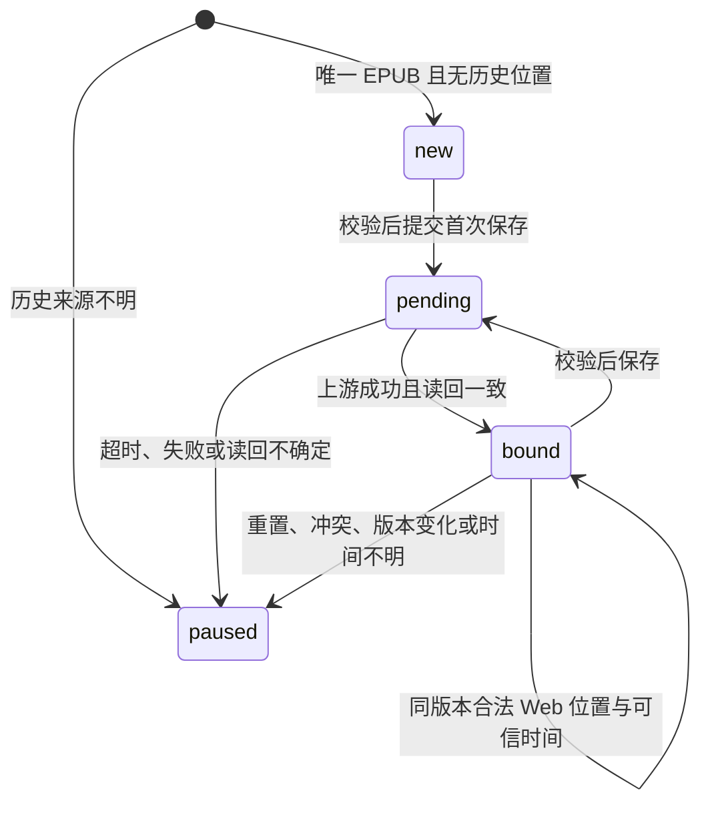

# 协议与同步契约

## 上游接口（v3.5.0）

| 用途 | 方法与路径 | 注意 |
|---|---|---|
| 认证 | `POST /api/v1/auth/login`、`POST /api/v1/auth/refresh` | 刷新按设备会话串行，不重放不确定的进度写入 |
| 用户 | `GET /api/v1/users/me` | 校验用户 ID；下载权限不沿用登录快照 |
| 书架 | `GET /api/v1/books/page` | 分页 ID 排序；每本再次读详情验证访问及内容限制 |
| 详情及聚合位置 | `GET /api/v1/books/{bookId}` | 聚合位置不含来源文件 ID/版本 |
| EPUB | `GET /api/v1/books/{bookId}/content` | 仅唯一主 EPUB；适配器额外检查下载权限 |
| 封面 | `GET /api/v1/media/book/{bookId}/cover` | 先检查该书权限 |
| 写位置 | `POST /api/v1/books/progress` | 自行校验 Book→File 归属、版本、锚点及绑定 |

不使用 `/books/{id}/files/{fileId}/download` 获取主书籍，也不回退到其他用户或原生 OPDS Basic 凭据。`bookType=EPUB` 不能选择精确文件 ID；首版只接受唯一主 EPUB，因此无需格式选择器。

参考源码：[BookController](../ref/grimmory/backend/src/main/java/org/booklore/controller/BookController.java)、[ReadingProgressService](../ref/grimmory/backend/src/main/java/org/booklore/service/progress/ReadingProgressService.java)、[BookLoreUser](../ref/grimmory/backend/src/main/java/org/booklore/model/dto/BookLoreUser.java)。`ref/` 为本地研究输入，不放入生产镜像。

## 客户端接口

Reader 返回 `{isSuccess,errorMsg,data}`。实际测试确认小幻的核心调用为：

| 方法 | `/reader3/` 下的路径 | 输入 |
|---|---|---|
| POST | `login` | JSON `username/password`，用于配置登录 |
| GET | `getUserInfo` | 设备令牌 |
| POST | `logout` | 设备令牌 |
| GET | `getBookshelf` | 设备令牌；只列已获取、版本有效的 EPUB |
| GET | `getShelfBook` | `url` |
| GET / POST | `getBookInfo`、`getChapterList` | 查询 `url` 或 JSON `url`/`book.bookUrl`/`searchBook.bookUrl` |
| POST | `saveBookProgress` | JSON `url,index`，index 为必需的整数 |
| GET / POST | `getBookContent` | 返回 `USE_OPDS_EPUB_IMPORT` |

令牌使用查询 `accessToken`；也支持配置页 Cookie、Bearer 和 OPDS Basic 密码。多种凭据冲突会拒绝。书籍 URL 为同步标识，不是可直接下载或任意访问的服务器地址。`v` 不作为读写时间。未实现的修改书库接口返回错误。

OPDS 为 Atom acquisition feed，`/opds?page=0` 开始，每页最多 50 条上游书籍，包含下一页链接。空页仍可能有下一页（例如过滤了无权访问或多格式的书），不能提前视为结束。`/books/{id}/epub` 基于派生文件生成 ETag、长度和 Range，支持 200/206/416 与条件请求；每次都先重新鉴权。

## 位置转换

EPUB 3 nav 或 EPUB 2 NCX 按导航顺序扁平化，无导航按 spine。要求导航位置可解析、唯一且按阅读顺序递增；不猜测外部链接、无效锚点或非单调导航。支持 UTF-8、带 BOM 或 XML 签名的 UTF-16。资源直接保留；只在 OPF 增加 `legado:*` 元数据，在章节起点加入兼容注释，不增加可见 DOM 元素。该规则改变时必须更新映射版本。

CFI 支持可验证的 package/spine 路径、元素与文本步、UTF-16 字符偏移和同文档正向范围。实际 Foliate 双页视口范围可能横跨目录章节：仅当精确 href 锚点位于该有效范围内时，才用它确定恢复章节；写回仍清除跨章 CFI，不能把它当作目标单章的精确位置保留。无法解析的 CFI（含不支持的空间/时间定位）、无锚点可消歧的跨章范围、CFI/href 冲突、无法唯一归属的 fragment+章节内百分比会暂停，不能自动忽略有效性问题并写入其他章节。CFI 优先于 href；无精细位置时使用源章节 href/fragment；仅有百分比时只能估算章节。百分比估算以 spine 文档大小和文档区域为权重，不等同真实阅读字数百分比。

## 状态与来源

`new` 返回书籍元数据但省略全部云端进度字段，不用 0 占位；`paused` 返回明确错误。503 不变成章节零，也不授权保存端略过检查。暂停持久化，无静默重试、排队覆盖、自动迁移或强制解锁。

绑定粒度为用户、Book ID、File ID、源 SHA-256 与映射版本。建立后接受同版本 Web 正常更新，依赖“唯一 EPUB、仅 Web/Adapter 正常写入”的运行契约。短暂新增再删除格式、其他不可见写入路径、聚合 DTO 无法辨别的来源和操作间竞态不在保证范围。首次保存前重读上游，读回与请求字段比对仍不能形成跨服务原子性保证。

`durChapterTime` 仅使用绑定下实际位置的 `lastReadTime`。同一位置仅聚合时间变化，不更新已公布的位置时间。改变位置却无新可信时间会暂停。适配器选择最后到达写入，允许回退；它不能区分小幻主动跳章与打开自动保存，不能阻止所有过期设备覆盖，也不把较高百分比认作较新位置。

真实 MariaDB 测试还确认：v3.5.0 的进度读回只有秒级时间。不同位置若落在同一秒，严格的时间检查会持久暂停，而不是制造一个更新的时间。正常跨秒的 Web 更新已通过 REST 往返验证；同秒暂停是当前契约的实际限制。

## 错误排查

| 代码 | 行为与处理 |
|---|---|
| `HISTORICAL_PROGRESS_UNBOUND` | 原书已有位置，保留它；首版没有历史迁移入口 |
| `UNSUPPORTED_BOOK_FILES` / `BOOK_FILES_CHANGED` | 非唯一 EPUB 或文件集合改变，拒绝同步 |
| `EPUB_VERSION_MISMATCH` / `EPUB_VERSION_CHANGED` | 本地版本过期，旧 URL 拒写；新版本历史进度仍需明确归属 |
| `UPSTREAM_PROGRESS_RESET` | 已绑定位置被上游清空，暂停而非当成新书 |
| `PROGRESS_TIME_UNKNOWN` / `PROGRESS_TIME_AMBIGUOUS` | 不伪造时间，不承诺自动恢复 |
| `INVALID_PROGRESS_CFI` / `CONFLICTING_PROGRESS_POSITION` | 无法保证目标章节一致，保留上游记录 |
| `UPSTREAM_WRITE_UNCONFIRMED` / `WRITE_READBACK_FAILED` | 写入结果可能已生效，禁止后台重试 |
| `DOWNLOAD_PERMISSION_REQUIRED` | 当前用户缺少下载权限；不因缓存命中绕过 |
| `CACHE_BUSY` | 当前缓存条目均在使用或达到容量限制，稍后重试 |

配置页的状态是最后一次验证或保存结果，不是持续后台探测。`lastSuccess` 为适配器最后一次保存并读回成功的时间，不伪装成上游阅读时间。
